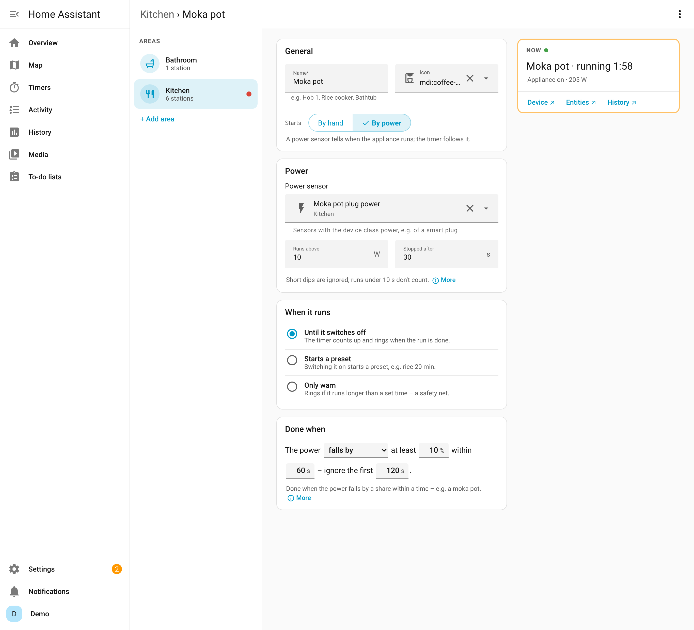
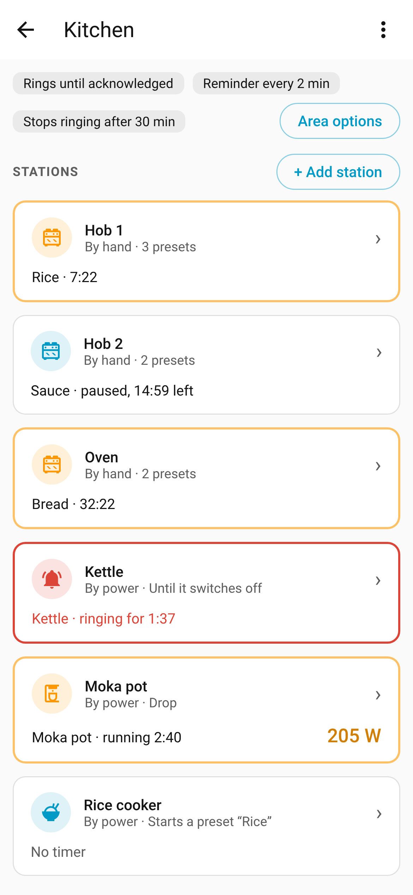

# The Home Timer panel

[← Back to the overview](../README.md)

Areas, stations, presets and options are set up in Home Timer's own panel – not in dialogs. It is for administrators and works on the phone as well.

## Opening it

- **The cog of an area:** Settings → Devices & services → Home Timer → the cog next to an area opens the panel at that area.
- **A device's link:** on the page of an area's *Home Timer* device or of a station's device, the configuration link (*Visit*) opens the panel there.
- **After adding an area:** the confirmation links to the panel.
- **The sidebar (optional):** the panel is hidden from the sidebar by default. Turn it on in the panel: ⋮ at the top right → *Panel settings* → *Show in the sidebar* (for all areas and users with admin rights).

Stations have no cog and no "Add station" on the integration page: they are added and changed in the panel. They are still subentries of the area's entry, with their own devices and entities; their ⋮ menu there still offers *Rename* (without the panel's check for unique names) and *Delete*.

The panel exists while Home Timer is loaded, i.e. while at least one area is set up. After removing the last area and restarting, add the first area again with Settings → Devices & services → Add integration → **Home Timer**.

## Layout

On a computer the areas are on the left and the chosen area or station on the right. On a phone you go from the list of areas to an area and on to a station.

**An area** shows its options in short, its **stations** as cards with what they do right now (timer and remaining time, ringing, the appliance's power) and its **quick timers**. Timers running without a station are listed below. The panel shows this live, but it does not operate timers – that is what dashboards, the devices' buttons and the actions are for.

**+ Add area** offers Home Assistant's areas that have no Home Timer yet. **Area options** (or a quick timer) opens the area's options and quick timers.

The ⋮ menu at the top right holds the panel settings, a link to this documentation and – on an area or a station – removing it.

## Area options

| Setting | |
|---|---|
| Ring until acknowledged, reminder, stop ringing after, report missed timers | see [Timers](timers.md#options) |
| Quick timers | presets without a station: name, duration, optional note; sort them by dragging or with the arrows |
| ⋮ → Remove Home Timer from this area | deletes the area's entry with its stations, devices and stored timers |

## Stations

**+ Add station** on an area, or a station's card, opens the station:

- **General:** name, icon (Home Assistant's icon picker) and how it **starts**: *By hand* – presets and buttons, see [Stations and presets](stations.md) – or *By power* – a power sensor drives the timer, see [Power stations](power.md). Names are unique within the area.
- **Power** (by power): the power sensor – Home Assistant's entity picker, offering sensors with the device class *power* – and when it counts as running and stopped.
- **When it runs** (by power): until it switches off, starts a preset, or only warn.
- **Done when** (until it switches off): the done rule as a sentence, e.g. *The power falls by at least 10 % within 60 s – ignore the first 120 s.* Change the rule in the sentence; ⓘ explains all rules.
- **Presets:** name, duration (`9` = 9 minutes, `9:30`, `1:05:00`), optional note. Sort them by dragging or with the arrows (on a phone, note and delete are behind ⋯); the buttons follow. Renaming a preset keeps its button.
- **⋮ → Delete station:** a timer running on it is cancelled (`reason: station_removed`).

The card **Now** (on a phone at the top) shows what the station does right now, with links to its device, its entities and its history.

On a phone:

 

## Saving

Changes collect in a bar at the bottom: **Save** or **Discard**. Saving reloads the area once; running timers go on. Leaving the page within the panel, reloading or closing the tab with unsaved changes asks first; leaving it otherwise (browser back, the sidebar, a link) discards them.

Errors are shown next to their field, and nothing is saved until they are fixed. If the area or station was changed elsewhere in the meantime – e.g. *Save as preset* on a dashboard – the save is refused and the current state is loaded, so nothing is overwritten.
