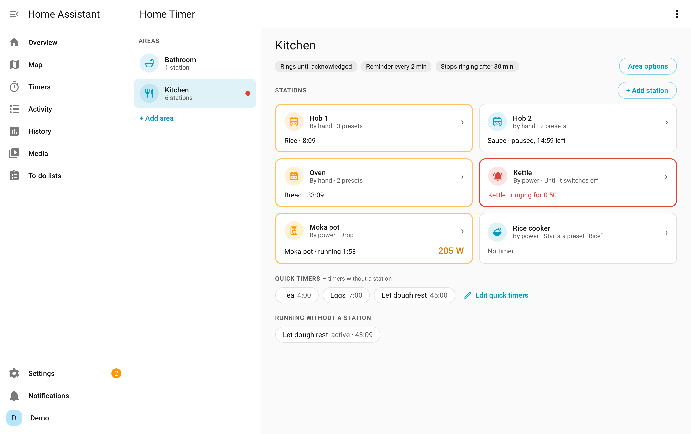
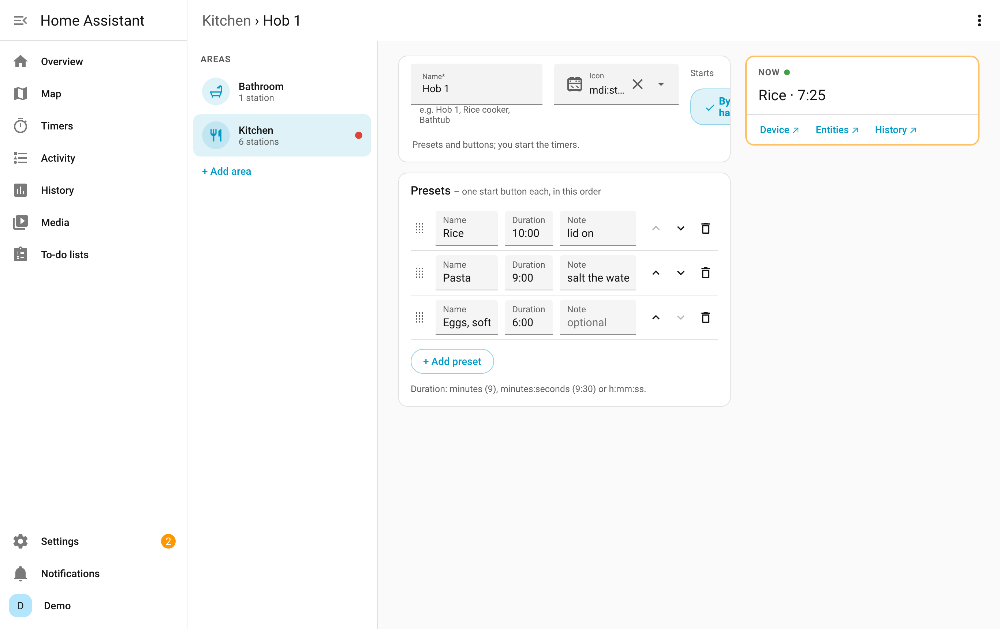
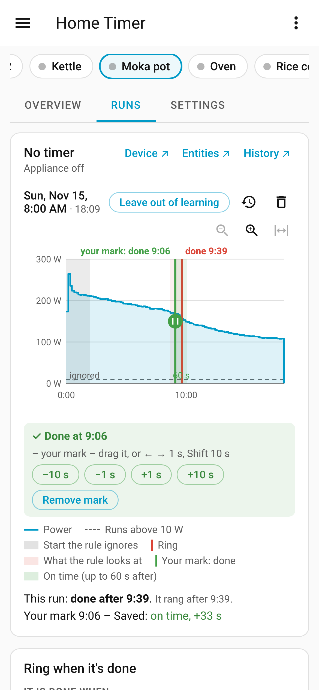
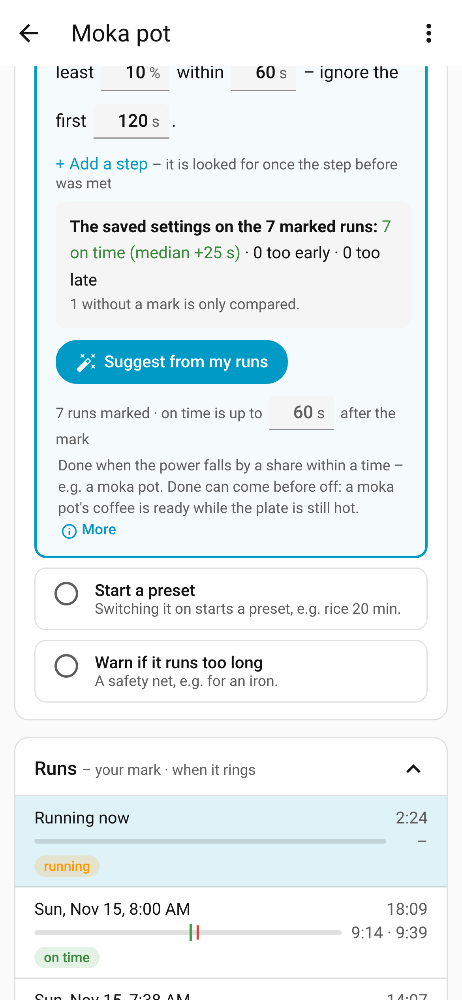

# The Home Timer panel

[← Back to the overview](../README.md)

Areas, stations, presets and options are set up in Home Timer's own panel – not in dialogs. It is for administrators and works on the phone as well.

## Opening it

- **The cog of an area:** Settings → Devices & services → Home Timer → the cog next to an area opens the panel at that area.
- **A device's link:** on the page of an area's *Home Timer* device or of a station's device, the configuration link (*Visit*) opens the panel there.
- **After adding an area:** the confirmation links to the panel.
- **The sidebar (optional):** the panel is hidden from the sidebar by default. Turn it on in the panel: ⋮ at the top right → *Panel settings* → *Show in the sidebar* (for all areas and users with admin rights).

Stations have no cog and no "Add station" on the integration page: they are added and changed in the panel. They are still subentries of the area's entry, with their own devices and entities; their ⋮ menu there still offers *Rename* (without the panel's check for unique names) and *Delete*.

The panel exists while Home Timer is loaded, i.e. while at least one area is set up. After removing the last area and restarting, add the first area again with Settings → Devices & services → Add integration → **Home Timer**.

## Layout

On a computer the areas are on the left and the chosen area or station on the right. On a phone you go from the list of areas to an area and on to a station.

**An area** shows its options in short, its **stations** as cards with what they do right now (timer and remaining time, ringing, the appliance's power) and its **quick timers**. Timers running without a station are listed below. The panel shows this live, but it does not operate timers – that is what dashboards, the devices' buttons and the actions are for.

**+ Add area** offers Home Assistant's areas that have no Home Timer yet. **Area options** (or a quick timer) opens the area's options and quick timers.

The ⋮ menu at the top right holds the panel settings, a link to this documentation and – on an area or a station – removing it.

## Area options

| Setting | |
|---|---|
| Ring until acknowledged, reminder, stop ringing after, report missed timers | see [Timers](timers.md#options) |
| Quick timers | presets without a station: name, duration, optional note; sort them by dragging or with the arrows |
| ⋮ → Remove Home Timer from this area | deletes the area's entry with its stations, devices and stored timers |

## Stations

**+ Add station** on an area, or a station's card, opens the station:

- **At the top:** name, icon (Home Assistant's icon picker) and how it **starts**: *By hand* – presets and buttons, see [Stations and presets](stations.md) – or *By power* – a power sensor drives the timer, see [Power stations](power.md) and [below](#a-station-by-power). Names are unique within the area.
- **Presets:** name, duration (`9` = 9 minutes, `9:30`, `1:05:00`), optional note. Sort them by dragging or with the arrows (on a phone, note and delete are behind ⋯); the buttons follow. Renaming a preset keeps its button.
- **⋮ → Delete station:** a timer running on it is cancelled (`reason: station_removed`).

The card **Now** (on a phone at the top) shows what a station by hand does right now, with links to its device, its entities and its history; a station by power shows it at the top of its curve.

On a phone:

## A station by power

Everything is on one page, so a change shows at once what it does with the station's real runs:

- **The curve** of the chosen run, with what the station does right now and links to its device, entities and history. Marked in it: the *runs above* threshold (dashed), the start the done rule ignores (grey), where the run stopped (*off*), and when it rings – a solid line for the saved settings, a dashed one for your changes while they are not saved (the **preview**). For *the power falls by* and *the trend bends …*, the rule's window is shaded; with steps, numbered pins show where each step was met; for *pauses* and *stops cycling*, its level is drawn. Point at the curve to read a value. **Zoom** into a run longer than a minute with 🔍 (or Ctrl + wheel, a touchpad pinch, or + − 0 on the focused chart) – zooming in keeps your mark in view. Zoomed in, the power scale fits the part shown (↕ gives the whole range back), and an overview of the whole run below the chart marks the part shown: drag it to move along, drag its edges to make it wider or narrower (or use a sideways wheel, or ← → when not marking). A run going on right now is shown live.
- **What should the timer do?** – *Ring when it's done*, *Start a preset* or *Warn if it runs too long*; the chosen answer's own setting opens under it. Under *Ring when it's done*: **It is done when …**, the done rule as a sentence, e.g. *the power falls by at least 10 % within 60 s – ignore the first 120 s*; ⓘ explains all rules. **+ Add a step** turns it into steps, *it is done after these steps*, joined by *then*: move them with ▲ ▼ or by dragging, remove them with × (see [Power stations › Steps](power.md#steps)). While you change it, a summary says what your draft does on all stored runs – e.g. *3 done earlier (median 12 s) · 5 unchanged* – and which runs it would never call done.
- **On and off:** the power sensor and, as a sentence, when the appliance runs and counts as off. The preview follows these too, within each stored run.
- **Runs:** newest first, with duration and when it rings – saved → draft while you change something; click one to see its curve. The history icon reads a run again from the recorder (its real start and whole curve – see [Runs](power.md#runs)); the bin icon deletes a run (it asks first). **✎ Phases** marks the run's phases on a bar under the curve (see [Phases](power.md#phases)). Runs read from the history, or recorded with another sensor, are marked.
- **Sensor:** how often it reports and how much its readings scatter.

**Learning:** mark in a few runs when the appliance was really done – click the curve, drag the mark, or *Done now* while it runs – and *Suggest from my runs* offers rules that fit (see [Power stations › Learning](power.md#learning)). With marks, the preview says *on time*, *too early* or *too late* per run and in the summary; a run whose mark looks off is shown with *Check the mark*, *Leave this run out* and *Keep it*. A new station shows its runs once it is saved. On a phone, the page goes curve, what the timer should do, runs, then *On and off* (folded) – the panel remembers what is folded per device.

 

## Saving

Changes collect in a bar at the bottom: **Save** or **Discard**. Saving reloads the area once; running timers go on. Leaving the page within the panel, reloading or closing the tab with unsaved changes asks first; leaving it otherwise (browser back, the sidebar, a link) discards them.

Errors are shown next to their field, and nothing is saved until they are fixed. If the area or station was changed elsewhere in the meantime – e.g. *Save as preset* on a dashboard – the save is refused and the current state is loaded, so nothing is overwritten.
