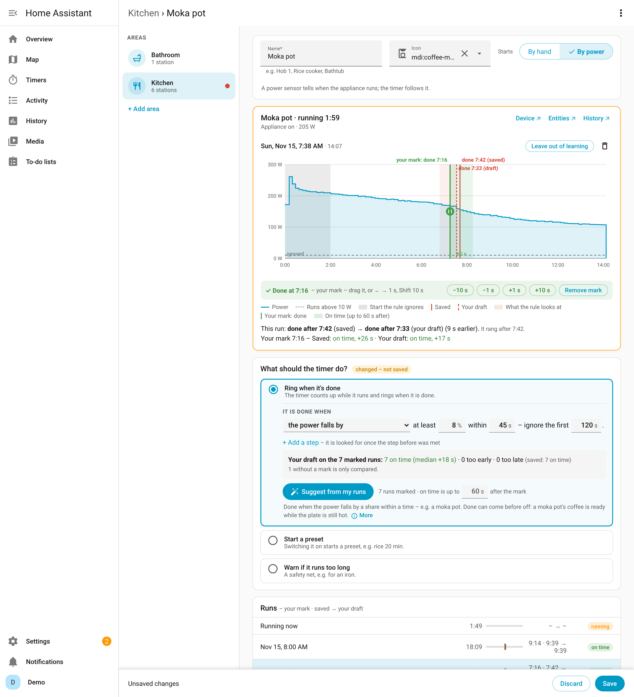
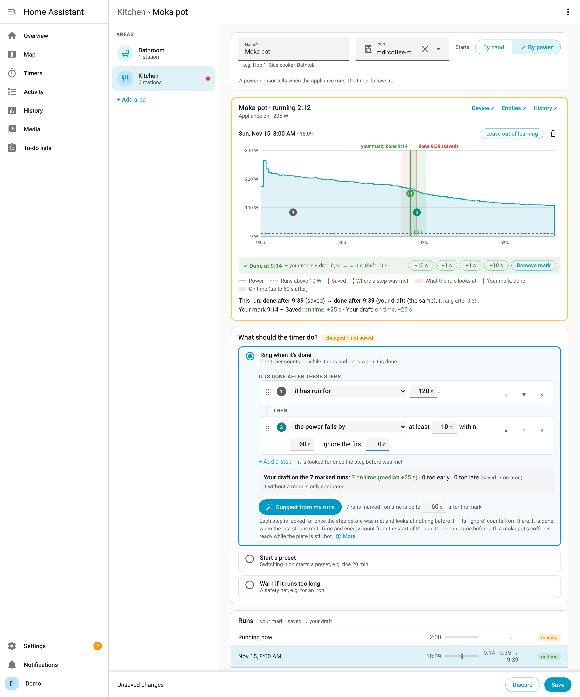
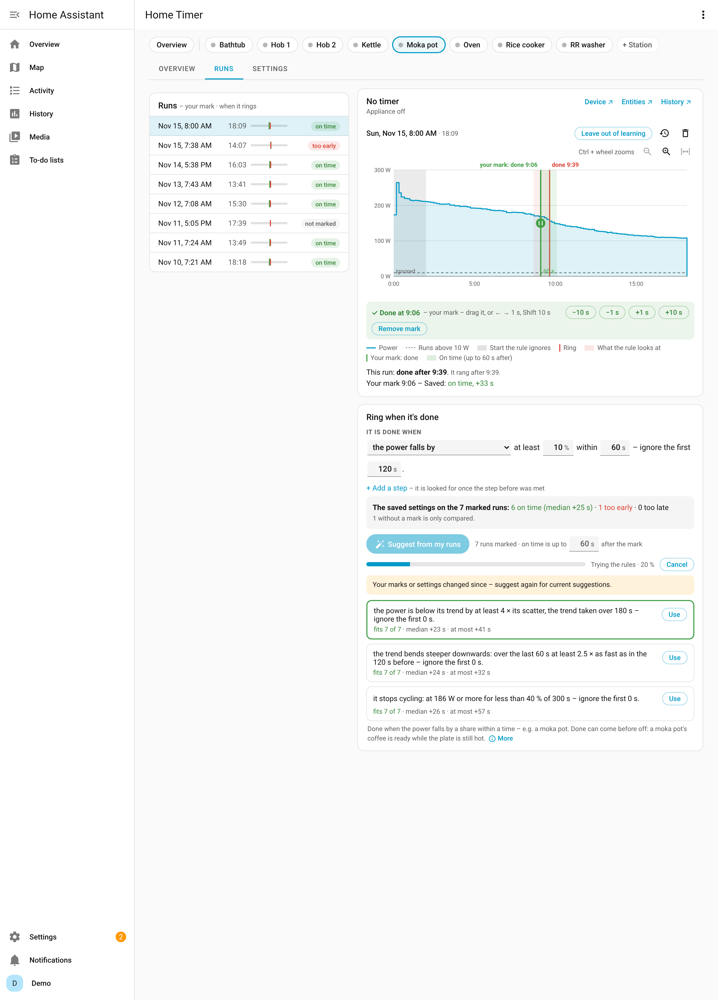

# Power stations

[← Back to the overview](../README.md)

A station can be started **by power** instead of by hand: a power sensor (e.g. of a smart plug) tells when the appliance runs, and the station's timer follows it. Good for small kitchen appliances – kettle, moka pot, rice cooker, toaster – and as a safety net for an iron or a heater.

> For washing machines, dryers and dishwashers with programs, a specialised integration that recognises programs (e.g. WashData) fits better.

## Setting it up

In the [panel](panel.md), add or open a station and set **Starts** to *By power*. The station's page then asks:

| Card | Setting |
|---|---|
| **On and off** | the power sensor (in W, e.g. `sensor.kitchen_plug_power`), and as a sentence: *It runs while the power is above 10 W and counts as off after 30 s below.* Short dips are ignored; a run shorter than 10 s is a blip – its timer is cancelled and it does not count |
| **What should the timer do?** | one of the three answers below; the answer's own setting opens under it – *it is done when …* for the first, the preset for the second, *warn after* for the third |

## Three kinds

| What the timer should do | Switched on | Then | Switched off |
|---|---|---|---|
| **Ring when it's done** | the timer counts up | *it is done when …* (the done rule) fires → it rings | not done yet: it rings now |
| **Start a preset** | the chosen preset starts (e.g. "Rice 20 min") | the preset's countdown ends → it rings | cancels the timer (optional) |
| **Warn if it runs too long** | a countdown *warn after* starts | after that time it rings ("forgotten?") | cancels it; if you acknowledge the warning while it still runs, it warns again (Stop silences it for this run) |

*Done* and *off* are not the same: a moka pot's coffee is ready while its plate is still hot, so its done rule fires before it switches off. For a kettle: *it is done when it switches off*.

A station that starts a preset keeps its manual controls (presets, custom timer, pause, +1 minute). The other two kinds have no presets or pause: the appliance decides.

The station only drives the timers it started itself (they carry `source: {home_timer: power}`). A timer you start at the station, or move there, is yours: switching the appliance off does not touch it. A timer of the station that you move to another station is left alone too.

## Done rules

For *ring when it's done*, the **done rule** (*it is done when …*) says when the run counts as done:

| Rule | Done when … | Fits |
|---|---|---|
| When it switches off | it has stopped | kettle, toaster |
| First pause | power stays below a level for a while | appliances that pause when done |
| Cycling | the share of time "on" within a window falls below a value | thermostat appliances |
| Drop | power falls by at least a share within a time | e.g. a moka pot: when the water is gone the power falls faster |
| The trend bends steeper downwards | power falls a factor faster than before | the same, independent of the power level |
| The trend flattens out | power falls a factor slower than before, or no longer | a curve that levels off |
| The trend turns upwards | power starts to rise after it fell or stayed | something switches on again |
| The trend bends steeper upwards | power rises a factor faster than before | heating that switches to a higher stage |
| Below its trend | power falls clearly below the line of its slow fall before; "clearly" follows the sensor's scatter | e.g. a moka pot – usually the earliest |
| Above its trend | power rises clearly above the line of its course before | something switches on at the end: a pump, a fan |
| Plateau | power stays at one level for a while after it changed | settles at a level, e.g. a rice cooker on keep warm |
| After a time / energy | a time has passed / energy has been used | only for very regular runs |

Every rule except *when it switches off* **ignores the first seconds** of a run (switch-on spikes). Example for an electric moka pot: *Drop · falls by ≥ 10 % within 60 s · first 120 s ignored* – it rang about 30 s after the coffee was ready, and never before.

### Steps

When one rule is not enough – it would also fire earlier, at a dip that is not the end – the done rule can be a **sequence of steps**: *it is done after these steps*, joined by *then* (**+ Add a step**, up to 8). Each step is looked for once the step before was met, and it looks at nothing before that moment – its *ignore the first …* counts from there; *after a time* and *after energy* count from the run's start. The timer rings when the last step is met. Example: *the power pauses, then the power falls by at least 30 % within 30 s* – a dip before the pause does not count. Move a step with ▲ ▼ or drag it; × removes it. *When it switches off* cannot be a step of a sequence. The timer's sensor shows how many steps are met (`steps_met`), and the curve shows where each step was met (numbered pins).

## The station's entities

| Entity | Description |
|---|---|
| `sensor.<area>_<station>` | the timer: idle, active, ringing; attributes `running`, `done_rule`, `steps_met` (with steps), `elapsed` … |
| `sensor.<area>_<station>_timer_end` | the expected end: the usual duration after the start (once it has run), or the warning time |
| `binary_sensor.<area>_<station>_running` | the appliance runs |
| `binary_sensor.<area>_<station>_ringing` | *Ringing* while its timer rings (done, or the warning), else *Quiet* – shown red while it rings |
| `sensor.<area>_<station>_runs` | how often it ran |
| `sensor.<area>_<station>_usual_duration` | median of the last 20 runs (until done, or until it stopped) |
| `button.<area>_<station>_stop_acknowledge` | acknowledges the ringing timer, or cancels the running one (the run itself goes on) |
| `button.<area>_<station>_done_now` | *ring when it's done* only: marks the run going on as done now – for [learning](#learning); it does not ring or stop anything |

Events carry `trigger: rule` or `trigger: off` when a run finishes, `reason: power_off` when switching off cancels a timer, and `by: power` when switching off acknowledges a ringing warning.

Once a run is done, its timer is an ordinary ringing timer: adding time snoozes it with a countdown. With *when it switches off*, it ends at the moment the power went down, not *stopped after* later.

## Runs

Every run is stored with its power curve when the appliance switches off (runs shorter than 10 s are blips and are not). The station's page in the [panel](panel.md#a-station-by-power) shows them: the curve with the *runs above* threshold, the start the done rule ignores, where the run stopped, and when the saved settings – and your changes, while they are not saved – would ring on it; when it really rang is written below. Per station the newest 30 runs are kept.

The first time Home Timer sees a power station, it reads the station's earlier runs once from the recorder's history of the sensor, as far as the recorder kept it (10 days by default). For those runs of a station *until it switches off*, when its done rule – as set at that moment – would have rung is worked out from the curve, and labelled as such. Only the history before the first run stored live is read, so no run appears twice. A station's runs are deleted with the station.

The tab also shows how often the sensor reports and how much its readings scatter. Both limit every rule: a sensor that reports every 10 s notices a change up to 10 s late, and scatter hides small changes.

## Learning

Which rule and values fit your appliance is easiest to learn from your own runs:

1. **Mark when it was done** – in a few runs, on the station's page: click the curve where the coffee was ready (or use *Mark done here*), then move the mark (drag it, ← → 1 s, Shift 10 s, or the −10/−1/+1/+10 s buttons; on a phone a tap sets it). While a run goes on, *Done now* marks it – also from a dashboard with the station's *Done now* button.
2. **Suggest from my runs** (from 3 marked runs): Home Timer tries every rule with many values on all marked runs. A suggestion must ring after each run's mark – never before comes first – and at most the **tolerance** after it (60 s by default, a setting of the station). The best of each rule type is offered (at most three), with how many runs it fits and its median and longest delay. Two steps (*A, then B*) are tried as well and offered first when they beat the best single rule – e.g. when a rule alone fires too early in some runs; longer sequences are set up by hand. It uses the newest 12 marked runs. A search takes a few seconds, longer with long runs: a bar shows how far it is, and *Cancel* stops it. It goes on when you leave the page – coming back shows its progress or its result.
3. **Use** puts a suggestion into the draft; the preview shows it on all runs, and **Save** makes it the station's rule.

With marks, the preview judges each run: *on time*, *too early* or *too late*. A run that the best suggestion misses while it fits the others is flagged *mark looks off*: check its mark, leave the run out of learning (it stays stored), or keep it. Marked runs are kept without limit (they are never dropped from the stored runs); a mark set with *Done now* survives a restart or a reload while the run goes on.

## Restarts

After a restart (or when the area reloads, e.g. after saving a preset) the first valid power reading decides – while the sensor is still unavailable, nothing happens:

- **Still running:** its timer goes on. The earlier readings are gone, so rules that look back (pause, drop, the trend changing, cycling) wait until they have a full window of new readings, and *energy* only counts from then. Steps already met stay met (while the steps are not changed).
- **Off:** it is handled like switching off – *until it switches off* rings, a warning is cancelled (or acknowledged if it rang), a preset is cancelled if set so. The run is not counted (nor stored), because its end is unknown.

A run that goes on across a restart is stored with the readings from the restart on; the panel says where its curve starts.
