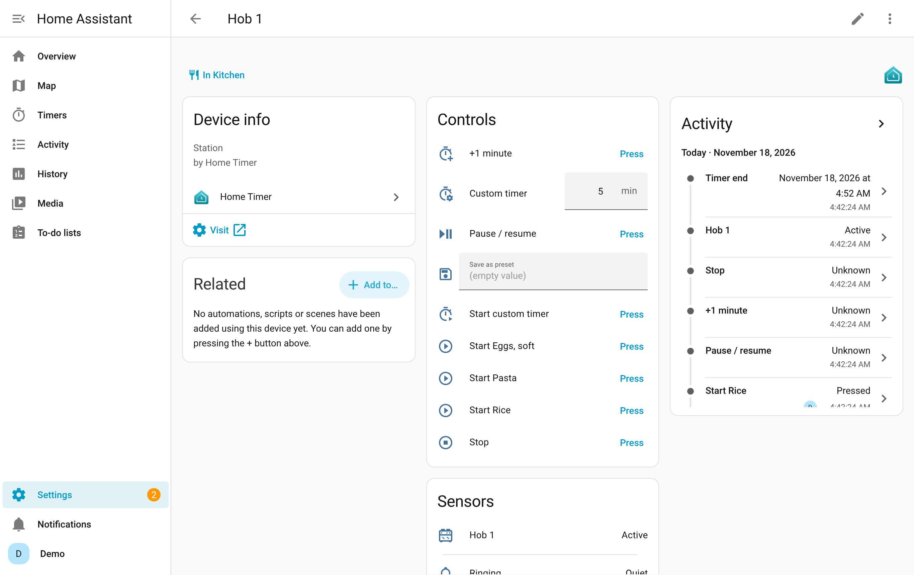

# Stations and presets

[← Back to the overview](../README.md)

A **station** is anything a timer belongs to: a hob, the rice cooker, the oven, the bathtub, the washing machine. Each station is its own device in the area, with **one timer at a time**, and has **presets** – known durations you start with one button.

## Adding a station

In the [panel](panel.md): open the area → **+ Add station**.

1. **Name and icon:** e.g. *Hob 1* with `mdi:stove`. Names are unique within the area. With an icon, the station's timer shows it in every state instead of the state icons.
2. **Starts:** *By hand* (as described here) or *By power* (see [Power stations](power.md)).
3. **Presets:** name (*Rice*), duration (10 min), optional note (*level 6, then 3*). The note goes with the timer's events, e.g. into a notification. Sort them by dragging or with the arrows.
4. **Save.** The area reloads; running timers go on.

Change a station later by opening it in the panel (or with the link on its device's page); ⋮ → **Delete station** removes it. A timer that runs on a deleted station is cancelled (`reason: station_removed`).

How you set up your stations is up to you – by place (*Hob 1*, *Hob 2*) with dishes as presets, or by appliance (*Rice cooker* with *White rice*, *Brown rice*). One station, one timer: for two timers on the same spot, add a second station.

## The station's device

The station's device carries its name and lies in the area (move it if you like). Its entities, e.g. for *Hob 1* in the kitchen (entity ids come from the names in your system language when the entities are created; the examples are for an English system – on a German one e.g. `button.kuche_kochfeld_1_reis_starten`):

| Entity | Description |
|---|---|
| `sensor.kitchen_hob_1` | the station's timer: *idle*, *active*, *paused* or *ringing*; details as attributes (see [Reference](reference.md#station)) |
| `binary_sensor.kitchen_hob_1_ringing` | *Ringing* while its timer rings, else *Quiet*; Home Assistant shows it red while it rings – a tile of it stands out on any dashboard |
| `sensor.kitchen_hob_1_timer_end` | when the timer runs out; the frontend shows "in 6 minutes" |
| `button.kitchen_hob_1_start_rice` | one button per preset: starts it (replacing the station's timer) |
| `button.kitchen_hob_1_pause_resume` | pauses or resumes the timer (available while it runs or is paused) |
| `button.kitchen_hob_1_1_minute` | +1 minute; a ringing timer starts again with one minute |
| `button.kitchen_hob_1_stop` | *Stop*: acknowledges a ringing timer, cancels a running or paused one (available while there is one; stations set up earlier keep `…_stop_acknowledge`, see [Reference](reference.md)) |
| `number.kitchen_hob_1_custom_timer` | custom duration in minutes, kept for next time |
| `button.kitchen_hob_1_start_custom_timer` | starts a timer "Timer" with the custom duration (replacing the station's timer) |
| `text.kitchen_hob_1_save_as_preset` | enter a name: saves the custom timer as a preset (see below) |



Renaming a preset keeps its button (its entity id stays); deleting a preset removes it.

## Creating presets while cooking

Presets do not have to be set up beforehand: set *Custom timer* (e.g. 9 minutes), press *Start custom timer*, and while it runs enter "Pasta" in *Save as preset*. The station gets a preset *Pasta* (9 min) with its button *Start Pasta*, and its timer is renamed "Pasta". A preset of the same name gets the new duration; if the custom timer is gone (acknowledged, cancelled, replaced or moved), the custom duration is saved. Saved presets show up in the station in the [panel](panel.md), where they can be changed or deleted. Saving reloads the area; the timer goes on.

## One timer per station

Starting a timer on a station that already has one replaces it: the old timer fires `home_timer_cancelled` with `reason: replaced`. Timers without a station (started on the area) are not affected; an area can have any number of those.

## Attaching a timer later

A timer started without a station – by a script, another integration, or a recipe – can be attached to a station afterwards, e.g. when the dough goes into the oven:

```yaml
action: home_timer.assign
target:
  entity_id: sensor.kitchen_oven
data:
  timer_id: "{{ timer_id }}"
```

It keeps its state and remaining time and from then on shows on the station's entities; a timer the station had is replaced. Its preset is kept only if the new station has a preset of that name. The station must be in the timer's area. Event `home_timer_assigned`, device trigger *Timer assigned to the station*.

## From automations and scripts

Target the station's device or one of its entities:

```yaml
action: home_timer.start
target:
  entity_id: sensor.kitchen_hob_1
data:
  preset: Rice            # or: name + duration
```

`note` replaces the preset's note; a preset brings its own duration, so `duration` is refused with a preset. Every event of a station's timer carries `station`, `station_name` and the station's `device_id`; device triggers on the station's device fire for its timer only. See [Automations](automations.md).
