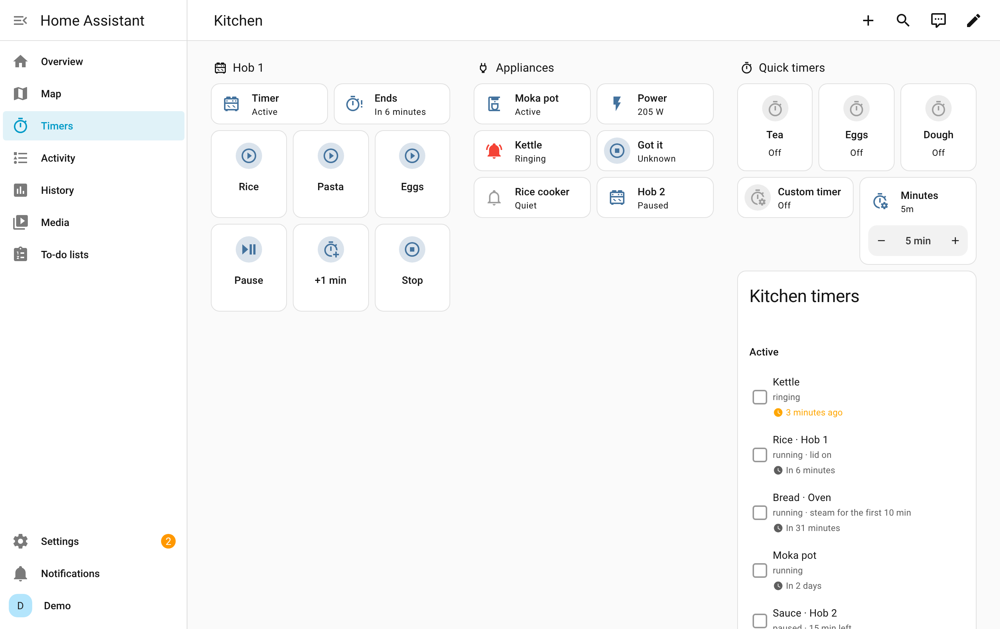

# Timers

[← Back to the overview](../README.md)

A timer belongs to an area and, optionally, to one of its [stations](stations.md). It has a name ("Let dough rest"), a duration, and optionally a note and source data of whoever started it. An area can have any number of timers without a station at once; a station has one timer at a time.

## Starting timers from a dashboard



The area's *Home Timer* device has controls for timers without a station, so a dashboard that shows the area's entities (e.g. the built-in area view) can start them without a custom card:

| Entity | Use |
|---|---|
| *<quick timer>* | one switch per quick timer of the area: on starts it, off stops it – or acknowledges it while it rings. It stays on while its timer runs, is paused or rings, so a tile shows it in colour; while it rings, its icon is a bell. Different quick timers run side by side; each has one run at a time (starting it again, e.g. by an action, starts it anew). |
| *<quick timer> ends* | when its timer runs out – or ran out, while it rings (the frontend shows "in 3 minutes") |
| *Custom timer minutes* | a duration in minutes (−/+ or typing), kept for next time |
| *Custom timer* | a switch: on starts a timer "Timer" with that duration, off stops it; *Custom timer ends* shows its end |
| *Save as preset* | enter a name: the last custom timer's duration (as started) becomes a quick timer of that name, and that timer is renamed – while it is still there (running, paused or ringing) and has not moved to a station; otherwise the custom duration is saved |

**Example:** set *Custom timer minutes* to 4, turn on *Custom timer*; while it runs, enter "Tea" in *Save as preset*. From now on there is a switch *Tea*, and the running timer is called "Tea" and is its run (unless *Tea* already runs). A quick timer of the same name gets the new duration instead of a duplicate (the timer takes over its note). Renaming fires no event; later events of the timer carry the new name.

Timers started otherwise (by an action with a name and duration) have no switch; they show in the area's [list of timers](#to-do-lists).

*The quick timers and the custom timer are switches now; the buttons* Start <quick timer> *and* Start custom timer *are gone. Running timers are taken over by their switch on the update.*

Quick timers are kept per area ([panel](panel.md) → **Quick timers**), where saved ones can be changed, sorted or deleted like any other. Saving reloads the area; running timers go on. Stations have the same controls for their own presets, see [Stations](stations.md#creating-presets-while-cooking).

## Life cycle

```
active ⇄ paused → ringing → acknowledged (or auto-dismissed)
   └──── cancelled ────┘
```

| State | Meaning |
|---|---|
| active | counting down |
| paused | stopped, keeps its remaining time |
| ringing | ran out, waits to be acknowledged; counts its overtime |

Cancelled and acknowledged timers are gone; an area without timers has nothing to show.

- **Add time** to an active or paused timer extends it; to a ringing timer, it starts it again with that time ("two more minutes").
- **Subtract time** shortens it; down to zero (also when paused) it runs out right away.
- **Assign** attaches a timer to a [station](stations.md#attaching-a-timer-later) of its area, keeping its time.
- Every change fires an [event](automations.md#events).

## Ringing

Home Timer makes no sound itself. "Ringing" is a state, and events tell your automations about it:

- `home_timer_finished` when the timer runs out,
- `home_timer_reminder` every few minutes while it rings (with the overtime),
- `home_timer_acknowledged` when it is acknowledged – by a station's *Stop* or the area's *Stop ringing* button, the to-do list, the action, or by itself after a while (`by: timeout`).

What happens then is up to you: a phone notification, an announcement, a light. See [Automations](automations.md).

## To-do lists

**Ringing timers, all areas.** Home Timer has one to-do list for all areas, *Home Timer: ringing timers* (`todo.home_timer_ringing_timers` on an English system): every ringing timer is an open to-do – "Rice · Hob 1 · Kitchen" (or "Dough · Kitchen" without a station), due since it ran out, with its note as the description. **Checking one off acknowledges the timer** (`by: todo`); it then leaves the list. Use it in the to-do panel, on a dashboard (to-do list card) or with the `todo` actions. The list belongs to Home Timer as a whole, so it has no device and no area.

The list only offers checking off: items cannot be added, renamed, deleted or moved, so it only ever holds ringing timers. Active and paused timers do not appear; acknowledged ones are gone (no history).

You find it in the to-do panel and under Settings → Entities (not on an area's entry or device). Like every to-do list it is exposed to Assist by default: "complete <item> on Home Timer: ringing timers" acknowledges a timer (the item's text must match); adding or removing items is refused. It is removed with the last area; setting up an area brings it back.

**Each area's timers.** Every area also has a list of all its timers, its stations' too: *Kitchen timers* (`todo.kitchen_timers`). Each timer is an open to-do – "Tea", or "Rice · Hob 1" on a station – due when it runs out (a ringing one is overdue since it ran out, so the frontend highlights it; a paused one has no due time, its description says how long is left; a power station's open timer is due at its usual end, if known). **Checking one off stops it** – or acknowledges it while it rings (`by: todo`). Nothing can be added, removed or moved. The list is in the area (set once when it is created) but not on the area's device, so it is named after the area, not "Home Timer"; a room's dashboard can show it with the to-do list card, which cannot filter a list by room.

## Options

Per area, in the [panel](panel.md) → **Ringing & reminders** (the cog of the area opens it), then **Save**. Saving reloads the area; running timers go on.

| Option | Default | Description |
|---|---|---|
| Ring until acknowledged | on | the timer stays *ringing* after it runs out. Off: it is gone right after `home_timer_finished`; timers that ring when you turn it off are acknowledged (`by: timeout`). |
| Reminder every | 2 min | while a timer rings, `home_timer_reminder` every so many minutes. 0: no reminders. |
| Stop ringing after | 30 min | a ringing timer is acknowledged by itself after so many minutes (`by: timeout`). 0: it rings until acknowledged. |
| Report missed timers | on | a timer that ran out while Home Assistant was restarting fires `home_timer_finished` with `late: true` right after the start. Off: it is dropped. |

## Restarts

Timers are stored with their end time, so a restart of Home Assistant loses nothing:

- an active timer goes on counting; if it ran out during the restart, see *Report missed timers*. Its overtime counts from when it ran out, but reminders and auto-dismiss count from the start, so you get the full time to react,
- a ringing timer keeps ringing; reminders and auto-dismiss continue from when it started ringing (if the auto-dismiss time has passed, it is acknowledged with `by: timeout`),
- a paused timer stays paused with its remaining time,
- a timer of a station deleted in the meantime is cancelled (`reason: station_removed`).

Missed timers are reported once Home Assistant has started, so automations triggered by the events see them.
